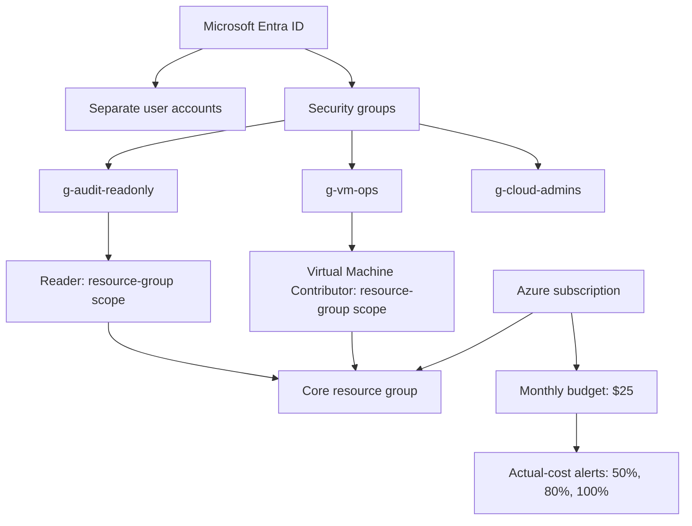
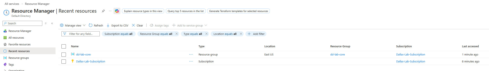
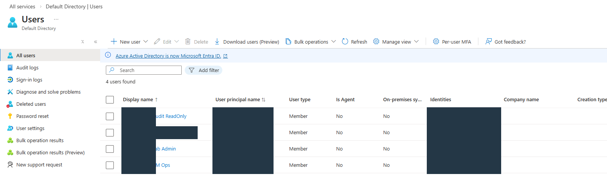
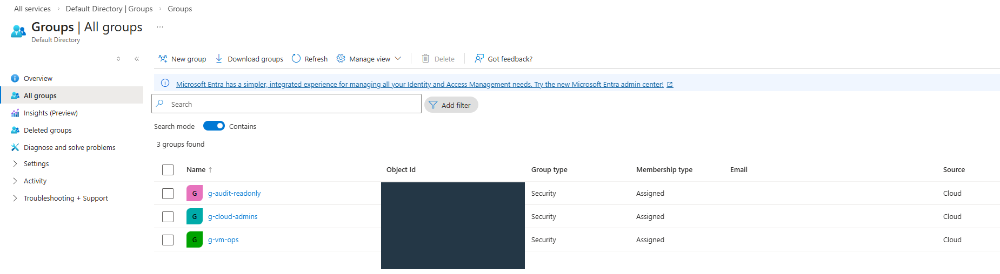
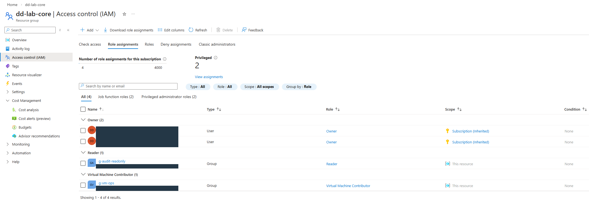
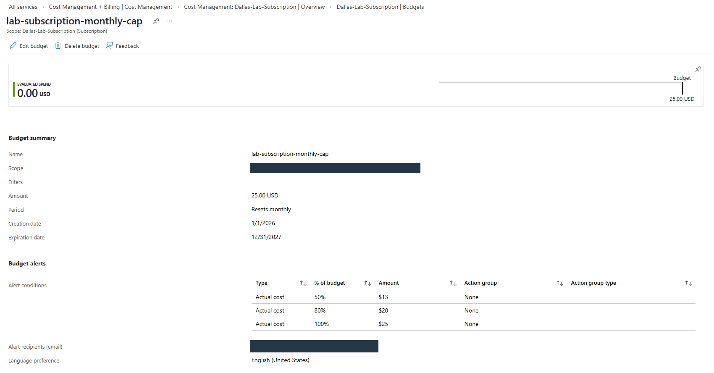

# Azure Identity and Governance Lab

**Microsoft Azure · Microsoft Entra ID · Security groups · Azure RBAC · Resource groups · Cost Management**

[Back to project overview](../README.md)

## Project overview

I built this project to practice organizing cloud identities, assigning access at the right scope, and keeping track of subscription costs. I created separate accounts and security groups for administration, VM operations, and read-only review, then used the resource group's Access control (IAM) page to inspect the resulting role assignments.

The main question I worked through was how an identity gets permission to manage a resource. I followed the relationship between users, groups, roles, and scope, then added a monthly budget so I could monitor spending while continuing to build in Azure.

## Architecture

| Component | Role in my project |
|---|---|
| Microsoft Entra ID | Held the cloud user accounts and security groups |
| Security groups | Organized identities by administration, operations, and audit responsibilities |
| Core resource group | Provided the scope for the Reader and Virtual Machine Contributor assignments |
| Access control (IAM) | Showed the assigned roles and whether access was inherited or assigned at this resource |
| Subscription budget | Tracked monthly spending against a $25 budget and configured alert thresholds |

## What I implemented and checked

| Area | Work completed | Validation |
|---|---|---|
| Identity organization | Created accounts for distinct responsibilities | Entra ID Users view with four accounts |
| Group organization | Created three cloud security groups with assigned membership | Groups view showing group names, type, membership type, and source |
| Scoped access | Assigned Reader to the audit group and Virtual Machine Contributor to the VM operations group | Resource-group IAM role assignments and recorded group role review |
| Resource organization | Established a core resource group in East US | Resource Manager listing |
| Cost monitoring | Configured a $25 monthly subscription budget with three actual-cost thresholds | Budget summary and alert settings |

## 1. Establish the resource scope

I used a core resource group to give the project a clear management boundary. The Resource Manager capture shows the group in East US alongside its subscription. This gave me a specific place to assign access instead of granting every project role across the entire subscription.

I checked the resource type, location, and subscription association before reviewing permissions. Those fields identify where the group sits in the Azure resource hierarchy.

## 2. Separate identities by responsibility

I created accounts for lab administration, VM operations, and read-only auditing alongside my existing account. Keeping those responsibilities separate helped me reason about which identity should receive each type of access.

The Users view shows four accounts with the Member user type. I used this view to review the account inventory before moving on to the groups and role assignments.

## 3. Organize access with security groups

I created three groups: `g-audit-readonly`, `g-cloud-admins`, and `g-vm-ops`. All three appear as cloud security groups with assigned membership. This structure let me organize access around a responsibility rather than treating each user as a separate permission assignment.

I checked the group type and membership type in this view. I then reviewed Azure role assignments separately, because creating a group is only one part of configuring access to resources.

## 4. Review roles and inheritance in IAM

At the resource-group level, I assigned **Reader** to `g-audit-readonly` and **Virtual Machine Contributor** to `g-vm-ops`. The IAM view shows both group assignments at **This resource**, while the Owner entries show **Subscription (Inherited)**.

| Identity shown | Role | Scope shown |
|---|---|---|
| Audit group | Reader | This resource |
| VM operations group | Virtual Machine Contributor | This resource |
| Existing owner account | Owner | Subscription (Inherited) |

The scope column was the most useful part of this review. It distinguished the group assignments I made at the resource group from access flowing down from the subscription. I also saw two Owner rows for the same account, so I would inspect the individual assignment details before deciding whether one should be removed.

### Recorded role review

[Watch or download the RBAC review excerpt](Video/Group_RBAC_Review.mp4)

This 10-second excerpt from my walkthrough shows the VM operations group's Azure role assignments. I reviewed the Virtual Machine Contributor role, the resource-group target, and the group receiving the assignment. The excerpt is silent and focuses on the assignment review.

## 5. Configure a monthly budget

I set the subscription budget to **$25 per month** and configured actual-cost alert thresholds at **50%, 80%, and 100%**. The budget summary shows a monthly reset and an email recipient configured for notifications.

| Setting | Configuration shown |
|---|---|
| Budget amount | $25 USD |
| Reset period | Monthly |
| Alert thresholds | 50%, 80%, and 100% of actual cost |
| Notification destination | Email recipient configured |
| Action group | None |
| Evaluated spend at capture | $0.00 USD |

I used the budget as a spending-monitoring control. The capture documents the configured thresholds and the current evaluated cost; checking delivery of a triggered budget email is a separate validation step.

## Validation and troubleshooting approach

| Question I would investigate | Where I would check first |
|---|---|
| A user cannot access the expected resource | Group membership, role assignment, target resource, and assignment scope |
| A user has broader access than expected | Inherited subscription assignments as well as assignments on the resource group |
| A group exists but has no resource access | The group's Azure role assignments and the resource's IAM view |
| A budget notification is missing | Budget scope, evaluated cost, threshold configuration, and recipient settings |

My next access test would use the audit and VM operations accounts directly. I would record an allowed operation and a denied operation for each account, then compare those results with the configured role and scope.

## What I learned

This project helped me connect identity management to resource access. I could see the accounts and groups in Entra ID, then follow the role assignments to the resource group where they applied. Reviewing inherited access also showed why checking only the assignments made directly on a resource can leave out part of the picture.

I approached cost monitoring in the same way: configure the control, inspect its scope and settings, and identify the next check needed to validate its behavior. That gave me a repeatable approach to documenting cloud administration work.

[Back to project overview](../README.md) · [Active Directory lab](../Active-Directory-Lab/README.md)
