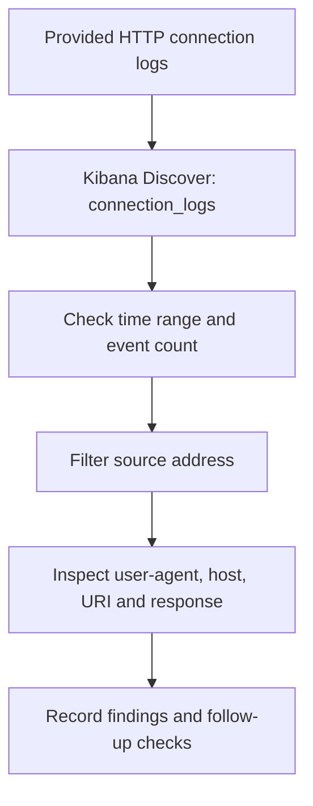

# ELK Suspicious Connection Investigation

**Kibana Discover · HTTP connection logs · Alert triage · Evidence analysis**

[Back to project overview](../README.md)

## Investigation overview

I worked through the **TryHackMe ItsyBitsy** scenario to practice investigating a potential command-and-control alert. The scenario described suspicious activity associated with an HR user and provided HTTP connection logs in the `connection_logs` index.

My task was to trace the relevant connection, identify the destination and requested resource, and inspect the file referenced by the exercise. I used Kibana Discover to move from the overall dataset to individual event fields.

## Environment and workflow

The exercise supplied the indexed logs. My documented work focused on searching and interpreting them in Kibana.



## Findings at a glance

| Evidence | Recorded result | What I took from it |
|---|---|---|
| Initial Discover search | 1,482 hits in the captured search window | A starting point for narrowing the dataset |
| Source filter | Two matching records for `192.166.65.54` | A small set of events to inspect individually |
| User-agent | `bitsadmin` | A reason to investigate the initiating process and transfer context |
| Host and destination | `pastebin[.]com`, `104.23.99.190`, port `80` | The destination details recorded in the event |
| Request and response | `HEAD`, status `200 OK` | A successful response to the recorded request |
| Exercise follow-up | My original notes identify `secret.txt` | The file named in the exercise follow-up; the challenge flag is omitted |

Addresses in this report are values from the training dataset. The destination is defanged in the text so it is not an active investigation link.

## 1. Establish the search scope

I opened Discover and selected `connection_logs`. Before filtering on a host, I checked the visible time range and document count so I knew which records the search covered.


**Evidence:** the initial search returned 1,482 hits.


The captured selector runs from **March 1, 2022 at 00:00 to March 31, 2022 at 00:00**. I report the count for that captured window. For a full calendar-month repeat search, I would use an upper boundary of April 1 at 00:00 and record the time zone.

## 2. Narrow the search to the source

I applied the source-address filter and displayed `source_ip` and `user_agent` together. That made it easier to compare the matching records before opening their details.

```text
source_ip: "192.166.65.54"
```


**Evidence:** Discover shows two records on March 10 with the same displayed timestamp and a `bitsadmin` user-agent. I would check record identifiers and ingestion details before treating them as two distinct network requests.

The user-agent gave me a useful pivot. It describes what the request claimed to be using; endpoint process records would help establish what actually generated it. A recurring beacon pattern would require a broader timing analysis.

## 3. Inspect the request fields

I expanded the event to inspect the source, destination, host, URI, method, and response together.


| Field | Value visible in the event |
|---|---|
| `source_ip` | `192.166.65.54` |
| `destination_ip` | `104.23.99.190` |
| `destination_port` | `80` |
| `host` | `pastebin.com` |
| `uri` | `/yTg0Ah6a` |
| `method` | `HEAD` |
| `status_code` / `status_msg` | `200` / `OK` |
| `user_agent` | `bitsadmin` |

I used the host and URI to identify the requested resource. The screenshot records the URI as `/yTg0Ah6a`; preserving its case and spelling matters when correlating events. The visible record shows port 80, so I do not label this event as a verified HTTPS connection.

A successful HEAD response establishes that the recorded request received a response. To investigate a content transfer, I would look for related GET requests, transfer records, and endpoint artifacts.

## 4. Follow the exercise evidence

My original walkthrough records inspecting the referenced resource in the exercise and identifying `secret.txt`. I keep that follow-up separate from what the HTTP event itself displays. The challenge flag remains omitted.

<details>
<summary>Additional original evidence captures</summary>


The field-selection capture shows the Discover context used during the search.


This capture accompanies the original resource follow-up.

</details>

## What I learned

The most useful part of this exercise was learning to read related fields together. An unusual user-agent gave me a starting point, but the host, URI, method, response, and timing made the finding more specific.

It also reinforced how much the search scope matters. A hit count depends on the time picker and filters, and matching rows need to be inspected before drawing conclusions about repeated activity.

## Follow-up investigation plan

If I continued this case with more telemetry, I would:

1. Correlate the source address with the endpoint and user at the event time.
2. Review process creation and BITS activity to identify the initiating command, parent process, and transfer job.
3. Search for additional requests to the same host and URI, including GET requests and transfer outcomes.
4. Inspect any recovered file and its hash in an isolated analysis environment.
5. Build a timeline linking the network activity to endpoint execution and any subsequent connections.

[Back to project overview](../README.md) · [Active Directory lab](../Active-Directory-Lab/README.md)
